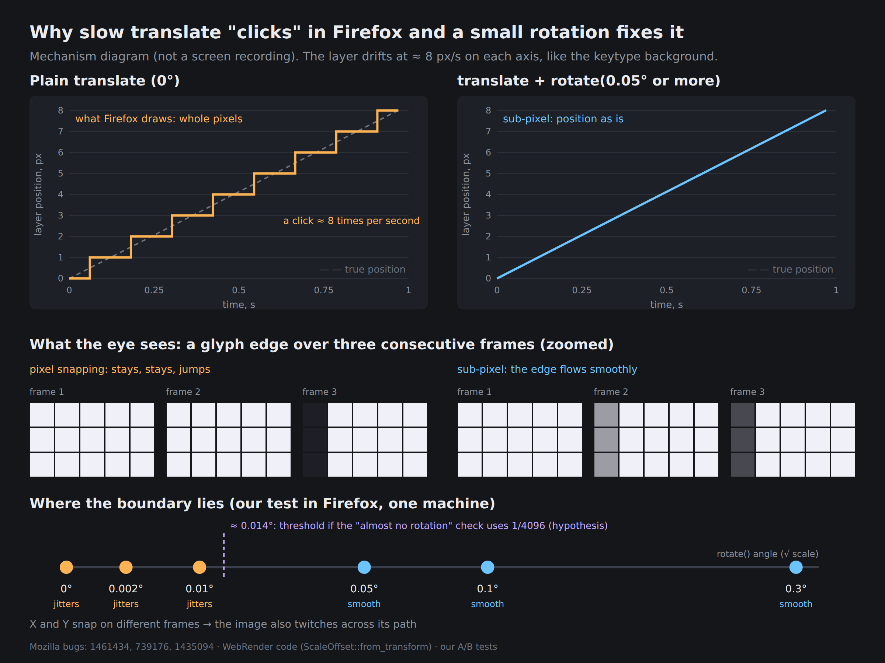

# Why a slow CSS translate animation jitters in Firefox, and how a small rotation fixes it

[Русская версия → README.ru.md](./README.ru.md)



> **Open the demos in your browser:** [anim-test](https://deltras-go.github.io/firefox-translate-snap/anim-test.html) · [demo](https://deltras-go.github.io/firefox-translate-snap/demo.html)
> Demos: [`anim-test.html`](./anim-test.html) — **the main one**, 8 squares with the same background moved in different ways (the jitter is most visible here); [`demo.html`](./demo.html) — a ladder of 7 angles with small text. Each page is a single self-contained file.
> Facts about Mozilla bugs were checked on 2026-10-21 against Bugzilla pages and commits; anything we are not sure about is marked "hypothesis".

## TL;DR

- In Firefox, a layer moved by a **plain `translate`** at a low speed (≈ 8 px/s) may be drawn at positions rounded to whole pixels. The motion turns into 1 px "clicks" and small details jitter.
- Chrome/Edge don't do this: they move the layer at fractional offsets and blur it slightly, but the motion is smooth.
- **A small rotation fixes it**: `transform: rotate(.3deg) translate3d(...)`. In our Firefox test it jitters at 0°, 0.002° and 0.01°, and becomes smooth from 0.05°.
- Mozilla has known about this for a long time and it is **still open**: [Bug 1461434](https://bugzilla.mozilla.org/show_bug.cgi?id=1461434) and [Bug 739176](https://bugzilla.mozilla.org/show_bug.cgi?id=739176) are both NEW.

## Symptom

[keytype](https://keytype.pro), a typing trainer, has an animated profile wallpaper: diagonal ribbons of the logo drift toward each other at ≈ 8 px/s. In Chrome and Edge it looks even. In Firefox the image "clicks" and trembles; small letters jump by a pixel, then freeze. One more thing: the jitter is not only along the path but also **across it**.

Page zoom matters too:

- Ctrl + "+" (page zoom): jitters.
- Pinch-zoom on a touchpad: no jitter (our observation; we did not investigate why).
- Any zoom in Chrome/Edge: no jitter.

## What we tried and what did not help

The layer is moved by the compositor with `transform: translate3d(...)`. We tested hypotheses one by one:

| Hypothesis | Result in Firefox |
| --- | --- |
| `steps()` instead of a smooth line | not the cause |
| Layer size | not the cause |
| `zoom: 1.35` on the container | not the cause |
| Round path ends to device pixels | worse |
| Mirrored path (both axes start from zero) | no help |
| Remove `will-change` | no help |
| `scale(1.002)` | no help |
| `background-position` instead of `transform` | no help |
| `rotate(.002deg)` and `rotate(.01deg)` | no help |
| **`rotate(.05deg)` and above** | **smooth** |
| `<canvas>` | smooth |

(A/B results by the author on one computer; Chromium shows no difference because it does not jitter at all.)

## What Mozilla says

| Source | What it says | Status on 2026-10-21 |
| --- | --- | --- |
| [Bug 739176](https://bugzilla.mozilla.org/show_bug.cgi?id=739176), 2012 | The reporter (Jake Archibald) shows that Firefox has no sub-pixel positioning for `translate` transitions but does have it with a tiny `rotate`. A Mozilla engineer replies that for active transforms coordinates are snapped to integers when rendering as a performance optimization, and that rotation needs buffer resampling, which blurs the image | NEW, S3, 7 votes |
| [Bug 1461434](https://bugzilla.mozilla.org/show_bug.cgi?id=1461434), 2018 | "We currently snap animated transforms if they are just a translation. Chrome doesn't seem to do this — it draws animated translations at fractional offsets, a bit blurry, which results in smoother movement" | NEW, P3/S3 |
| [Bug 663776](https://bugzilla.mozilla.org/show_bug.cgi?id=663776), 2011 | Jerky `scale` transition; the cause is named directly — snapping in `Layer::SnapTransform`; comment 4 suggests adding any `rotate()`, even too small to be visible | fixed for scale in Firefox 20 |
| [Bug 1435094](https://bugzilla.mozilla.org/show_bug.cgi?id=1435094), 2018 | A Mozilla engineer: Gecko turns off snapping if there is a transform other than a plain translation; WebRender "already disables pixel snapping on elements with a non-axis-aligned transform" | fixed in Firefox 61 |
| [Bug 1574493](https://bugzilla.mozilla.org/show_bug.cgi?id=1574493), 2019 | Snapping re-architecture in WebRender. One patch says the snapping transform "excludes animated transforms which are assumed to be the identity" | fixed in Firefox 71 |
| Bug 2001524 / 2045926, 2025–2026 | Snapping of reference-frame origins moves into WebRender, then becomes a per-surface frame-time pass. The November 2025 commit notes that one animated-transform test is fuzzy because of a separate bug in the animation/snapping code, to be fixed as a follow-up | commits [2001524](https://github.com/mozilla-firefox/firefox/commit/c35192456a26bb94d66cd75be9f3c32d5db4ddf0), [2045926](https://github.com/mozilla-releng/git-backing/commit/9015313f2a1c215754818dcc9c0ec856e20b985e) |
| Bug 2053638, July 2026 | Text under an animated transform was drawn with each glyph snapped independently and "wiggled"; it is now rasterized in local space. The description says the spatial tree "already avoids snapping animated transforms because it causes jitter (bug 637852); the text path never honored that" | commit [0a2e625](https://github.com/mozilla-firefox/firefox/commit/0a2e6250d8349912c27fd5dbd8822a9a263901df) |

## Why a rotation helps

From what the sources show:

1. Pixel snapping applies to **axis-aligned** transforms, i.e. translation and scale. For other ("complex") transforms WebRender computes empty snap offsets: in `get_unclipped_device_rect` the `TransformedRectKind::Complex` branch returns `SnapOffsets::empty()`.
2. A small rotation turns the layer from axis-aligned into "complex", and snapping stops applying to it. The price is resampling (slight blur), as the Mozilla engineer wrote in Bug 739176.

**Where a threshold between 0.01° and 0.05° could come from (hypothesis).** In WebRender, `ScaleOffset::from_transform` (which recognizes a "pure scale + translation") compares the off-diagonal matrix entries with `NEARLY_ZERO = 1/4096`, matching Skia's `SK_ScalarNearlyZero`. The sine of a small angle equals the angle in radians, so the threshold is about 2.44·10⁻⁴ rad ≈ **0.014°**. Our results fall on both sides: 0.01° is still "almost no rotation", 0.05° is not. This is a coincidence of numbers, not proof: I did not verify which check actually decides snapping in current Firefox, and the code excerpt comes from the WebRender copy on doc.servo.org, not from mozilla-central.

Older advice like "any rotation, even 0.01°, is enough" dates from the earlier Gecko (2011–2012). In modern Firefox, according to our tests, you need more.

## The fix

```css
@keyframes plv {
  from { transform: rotate(.3deg) translate3d(0, 0, 0); }
  to   { transform: rotate(.3deg) translate3d(var(--dx), var(--dy), 0); }
}
.layer {
  position: absolute;
  --m: max(12px, 1vw);               /* margin for the corners the rotation sweeps */
  left: calc(var(--x0) - var(--m));
  top:  calc(var(--y0) - var(--m));
  width:  calc(100% + var(--w) + var(--m) * 2);
  height: calc(100% + var(--h) + var(--m) * 2);
  will-change: transform;
  animation: plv var(--d) linear infinite;
}
```

Notes:

1. The layer is larger than its container by one tile plus the `--m` margin, otherwise the rotated corners expose the background.
2. The motion path matches the pattern's lattice vector so the loop closes without a seam: the translation happens *inside* the rotated coordinate system.
3. The project uses `.3deg`: a 6× margin over the 0.05° threshold in our test. The difference between 0.05° and 0.3° is barely visible.
4. A ~0.3° rotation slightly resamples the image, so thin lines may look a little soft. We do not notice it on the ribbon logo.

## CPU cost

Item preview cards used to draw an animated SVG (SMIL, main thread). After moving to compositor `transform` layers: 140–207 % → 29–30 % CPU (4 cards at once, software rendering in Chromium, CDP `cpuTime`). **[insert your own measurements on your hardware]**

## Test environment

- Browser: **Firefox 158.0 (64-bit)**, Windows.
- Laptop: Intel Core i5-12450H (4P+4E cores), NVIDIA GeForce RTX 3050 Laptop 4 GB, 16 GB DDR4, 15.6" IPS 1920×1080 **at 144 Hz**.
- Page zoom 100%; the jitter appears at any zoom level.
- **Refresh rate 144 Hz (hypothesis, untested on 60 Hz):** between two clicks the picture does not change for ~0.1 s, while smooth motion changes on every one of 144 frames, so the contrast between "stands, then jumps" and "glides" may be more noticeable on a high-refresh display than on 60 Hz.
- Not recorded: which GPU Firefox renders on (about:support → Graphics) and the Windows version.
- Whether the 2025–2026 snapping commits listed above are already in Firefox 158 was not verified.

## What is still unknown

- Other Firefox versions, other operating systems and other displays: snapping behavior changed in 2025–2026, so results may differ. We tested one version (158.0) on one laptop.
- The exact source of snapping in current Firefox: some messages say "Gecko snaps (display list)", others say "the WebRender spatial tree avoids snapping animated transforms". We know the empirical result but not which layer causes the clicks.
- The ≈ 0.014° threshold is a hypothesis from the code, not a measurement.
- Results come from one computer; per forums, rotation did not help some people.

## Try it yourself

The clearest example is [`anim-test.html`](./anim-test.html): 450×260 squares with the project's real background moved in different ways (translate, scale ×1.002, rotate 0.01° / 0.05° / 0.3°, no `will-change`, `background-position`, canvas). Open it in Firefox at 100% zoom and watch each square for 10–15 seconds. The ladder of 7 angles is [`demo.html`](./demo.html).

If it reproduces for you, consider adding a minimal example and your Firefox version to [Bug 1461434](https://bugzilla.mozilla.org/show_bug.cgi?id=1461434): it has been open since 2018.
