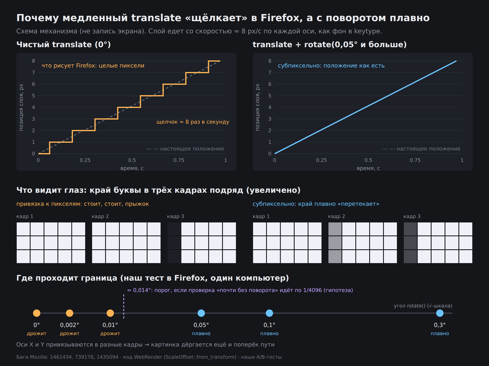

# Почему медленная CSS-анимация translate дрожит в Firefox и как её лечит небольшой поворот

[English version → README.md](./README.md)



> **Открыть демо в браузере:** [anim-test](https://deltras-go.github.io/firefox-translate-snap/anim-test.html) · [keytype](https://deltras-go.github.io/firefox-translate-snap/keytype.html) · [demo](https://deltras-go.github.io/firefox-translate-snap/demo.html)
> Демо: [`anim-test.html`](./anim-test.html) — **основное**, 8 квадратов с одним и тем же фоном и разными способами движения (именно здесь дрожь заметнее всего); [`keytype.html`](./keytype.html) — тот же фон на весь экран с кнопками угла; [`demo.html`](./demo.html) — лесенка из 7 углов с мелким текстом. Каждая страница — один самодостаточный файл.
> Факты о багах Mozilla проверены 21.10.2026 по страницам Bugzilla и коммитам; места, где мы не уверены, помечены словом «гипотеза».

## Коротко

- В Firefox слой, который двигается **чистым `translate`** с малой скоростью (≈ 8 px/с), может рисоваться в позициях, округлённых до целого пикселя. Движение превращается в «щелчки» по 1 px, мелкие детали дрожат.
- В Chrome/Edge такого нет: там слой двигается с дробными смещениями и немного размывается, зато плавно.
- **Лечится небольшим поворотом**: `transform: rotate(.3deg) translate3d(...)`. В нашем тесте в Firefox дрожит при 0°, 0,002° и 0,01°, плавно становится с 0,05°.
- Эта проблема в Mozilla известна давно и **остаётся открытой**: [Bug 1461434](https://bugzilla.mozilla.org/show_bug.cgi?id=1461434) и [Bug 739176](https://bugzilla.mozilla.org/show_bug.cgi?id=739176) в статусе NEW.

## Симптом

В тренажёре печати [keytype](https://keytype.pro) на странице профиля есть анимированные обои: диагональные ленты с логотипом едут навстречу друг другу со скоростью ≈ 8 px/с. В Chrome и Edge это выглядит ровно. В Firefox картинка «щёлкает» и дрожит, мелкие буквы то прыгают на пиксель, то замирают. Заметно ещё одно: дрожь идёт не только вдоль траектории, но и **поперёк неё**.

Масштаб страницы тоже влияет:

- Ctrl + «+» (масштаб страницы): дрожит.
- Щипок-зум на тачпаде: дрожи нет (наше наблюдение, причину не исследовали).
- Любой масштаб в Chrome/Edge: дрожи нет.

## Что мы пробовали и что не помогло

Слой двигается компоновщиком через `transform: translate3d(...)`. Мы проверяли гипотезы по очереди:

| Гипотеза | Итог в Firefox |
| --- | --- |
| Шаги `steps()` вместо плавной линии | не причина |
| Размер слоя | не причина |
| `zoom: 1.35` на контейнере | не причина |
| Округлить концы пути до физических пикселей | хуже |
| Зеркальный путь (обе оси стартуют с нуля) | не помогло |
| Убрать `will-change` | не помогло |
| `scale(1.002)` | не помогло |
| `background-position` вместо `transform` | не помогло |
| `rotate(.002deg)` и `rotate(.01deg)` | не помогло |
| **`rotate(.05deg)` и больше** | **плавно** |
| `<canvas>` | плавно |

(Результаты A/B-тестов автора на одном компьютере; в Chromium разницы нет вообще, потому что дрожи там нет.)

## Что говорят в Mozilla

| Источник | Что в нём | Статус на 21.10.2026 |
| --- | --- | --- |
| [Bug 739176](https://bugzilla.mozilla.org/show_bug.cgi?id=739176), 2012 | Автор отчёта (Jake Archibald) показывает, что Firefox не использует субпиксельное позиционирование при `translate`-переходах, зато использует при крошечном `rotate`. Инженер Mozilla отвечает: для активных transforms координаты привязываются к целым пикселям при отрисовке — это оптимизация производительности; при повороте нужно ресэмплировать буфер, поэтому картинка размывается | NEW, S3, 7 голосов |
| [Bug 1461434](https://bugzilla.mozilla.org/show_bug.cgi?id=1461434), 2018 | «Сейчас мы привязываем анимированные transform, если это просто сдвиг. Chrome, похоже, этого не делает: рисует анимированные сдвиги с дробным смещением, чуть размыто, но движение плавнее» | NEW, P3/S3 |
| [Bug 663776](https://bugzilla.mozilla.org/show_bug.cgi?id=663776), 2011 | Рывки у `scale`-перехода; причина названа прямо — привязка в `Layer::SnapTransform`; в комментарии 4 советуют добавить любой `rotate()`, даже слишком малый, чтобы быть заметным | исправлен для scale в Firefox 20 |
| [Bug 1435094](https://bugzilla.mozilla.org/show_bug.cgi?id=1435094), 2018 | Инженер Mozilla: Gecko отключает привязку, если есть transform, кроме чистого сдвига; WebRender «уже отключает привязку у элементов с не осево-выровненным преобразованием» | исправлен в Firefox 61 |
| [Bug 1574493](https://bugzilla.mozilla.org/show_bug.cgi?id=1574493), 2019 | Переработка привязки в WebRender. В одном из патчей: привязывающий transform «исключает анимированные преобразования, которые считаются тождественными» | исправлен в Firefox 71 |
| Bug 2001524 / 2045926, 2025–2026 | Привязку origin опорных кадров переносят в WebRender, затем делают покадровым проходом на уровне поверхности. В коммите от ноября 2025 отмечено, что один тест анимированного transform нестабилен из-за отдельного бага в коде анимации и привязки, который будет исправлен позже | коммиты [2001524](https://github.com/mozilla-firefox/firefox/commit/c35192456a26bb94d66cd75be9f3c32d5db4ddf0), [2045926](https://github.com/mozilla-releng/git-backing/commit/9015313f2a1c215754818dcc9c0ec856e20b985e) |
| Bug 2053638, июль 2026 | Текст под анимированным transform рисовался с независимой привязкой каждого глифа и «дрожал»; теперь рисуется в локальном пространстве растра. В описании: дерево пространств «уже избегает привязки анимированных transform из-за джиттера (bug 637852), но путь текста так не делал» | коммит [0a2e625](https://github.com/mozilla-firefox/firefox/commit/0a2e6250d8349912c27fd5dbd8822a9a263901df) |

## Почему именно поворот

Из того, что видно в источниках:

1. Привязка к пикселям делается для **осево-выровненных** преобразований, то есть для сдвига и масштаба. Для прочих («сложных») преобразований WebRender считает смещения привязки пустыми: в коде `get_unclipped_device_rect` ветка `TransformedRectKind::Complex` возвращает `SnapOffsets::empty()`.
2. Небольшой поворот переводит слой из осево-выровненного в «сложный», и привязка перестаёт к нему применяться. Цена — ресэмплинг (лёгкое размытие), о котором писал инженер Mozilla в Bug 739176.

**Откуда порог между 0,01° и 0,05° (гипотеза).** В коде WebRender функция `ScaleOffset::from_transform` (распознаёт «чистый масштаб + сдвиг») сравнивает недиагональные элементы матрицы с константой `NEARLY_ZERO = 1/4096`, как `SK_ScalarNearlyZero` в Skia. Синус малого угла равен самому углу в радианах, поэтому порог — около 2,44·10⁻⁴ рад ≈ **0,014°**. Наши результаты ложатся по обе стороны: 0,01° всё ещё «почти без поворота», 0,05° уже нет. Это совпадение, а не доказательство: я не проверял, какая именно проверка принимает решение о привязке в текущем Firefox, а пример кода взят из копии WebRender на doc.servo.org, а не из mozilla-central.

Старые рекомендации «хватит любого поворота, хоть 0,01°» относятся к прежнему Gecko (2011–2012). В современном Firefox, судя по нашим тестам, нужно больше.

## Решение

```css
@keyframes plv {
  from { transform: rotate(.3deg) translate3d(0, 0, 0); }
  to   { transform: rotate(.3deg) translate3d(var(--dx), var(--dy), 0); }
}
.layer {
  position: absolute;
  --m: max(12px, 1vw);               /* поле под углы, которые заметает поворот */
  left: calc(var(--x0) - var(--m));
  top:  calc(var(--y0) - var(--m));
  width:  calc(100% + var(--w) + var(--m) * 2);
  height: calc(100% + var(--h) + var(--m) * 2);
  will-change: transform;
  animation: plv var(--d) linear infinite;
}
```

Нюансы:

1. Слой больше контейнера на размер плитки плюс поле `--m`, иначе повёрнутые углы обнажают фон.
2. Путь движения совпадает с вектором решётки узора, чтобы цикл замыкался без шва: сдвиг идёт *внутри* повёрнутой системы координат.
3. В проекте оставлен `.3deg`: запас в 6 раз над порогом 0,05° в нашем тесте. Разница между 0,05° и 0,3° на глаз почти не видна.
4. Поворот на ~0,3° слегка ресэмплирует картинку: у тонких линий возможна небольшая размытость. На ленточном логотипе мы её не замечаем.

## Цена по процессору

Превью-карточки предметов раньше рисовали анимированный SVG (SMIL, основной поток). После перехода на слои `transform` на компоновщике: 140–207 % → 29–30 % CPU (4 карточки одновременно, программная отрисовка в Chromium, CDP `cpuTime`). **[вставить свои замеры на вашем железе]**

## Среда тестирования

- Браузер: **Firefox 158.0 (64-разрядный)**, Windows.
- Ноутбук: Intel Core i5-12450H (4P+4E ядер), NVIDIA GeForce RTX 3050 Laptop 4 ГБ, 16 ГБ DDR4, 15,6" IPS 1920×1080 **144 Гц**.
- Масштаб страницы 100%; дрожь есть при любом масштабе.
- **Частота экрана 144 Гц (гипотеза, на 60 Гц не проверялось):** между двумя щелчками картинка ~0,1 с не меняется, а плавное движение меняется на каждом из 144 кадров, поэтому контраст между «стоит, потом прыгает» и «плывёт» на экране с высокой частотой может быть заметнее, чем на 60 Гц.
- Не записано: на какой видеокарте рисует Firefox (about:support → Graphics) и версия Windows.
- Входят ли описанные выше коммиты 2025–2026 годов в Firefox 158, не проверено.

## Что осталось неизвестным

- Другие версии Firefox, другие ОС и другие экраны: поведение привязки менялось в 2025–2026 годах, результат может отличаться. Мы проверяли одну версию (158.0) на одном ноутбуке.
- Точный источник привязки в текущем Firefox: в одних сообщениях «привязывает Gecko (display list)», в других «дерево пространств WebRender избегает привязки анимированных transform». Мы знаем эмпирический результат, но не знаем, какой из слоёв отвечает за щелчки.
- Порог ≈ 0,014° — гипотеза по коду, не измерение.
- Результаты на одном компьютере; части людей (по форумам) поворот не помогал.

## Как проверить самому

Самый наглядный пример — [`anim-test.html`](./anim-test.html): квадраты 450×260 с настоящим фоном проекта и разными способами движения (сдвиг, масштаб ×1.002, поворот 0.01° / 0.05° / 0.3°, без `will-change`, `background-position`, canvas). Откройте в Firefox при масштабе 100% и смотрите на каждый квадрат 10–15 секунд. Тот же фон на весь экран с кнопками угла — [`keytype.html`](./keytype.html), лесенка из 7 углов — [`demo.html`](./demo.html).

Если у вас воспроизводится, стоит дописать в [Bug 1461434](https://bugzilla.mozilla.org/show_bug.cgi?id=1461434) минимальный пример и версию Firefox: он открыт с 2018 года.
